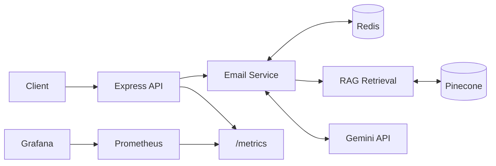
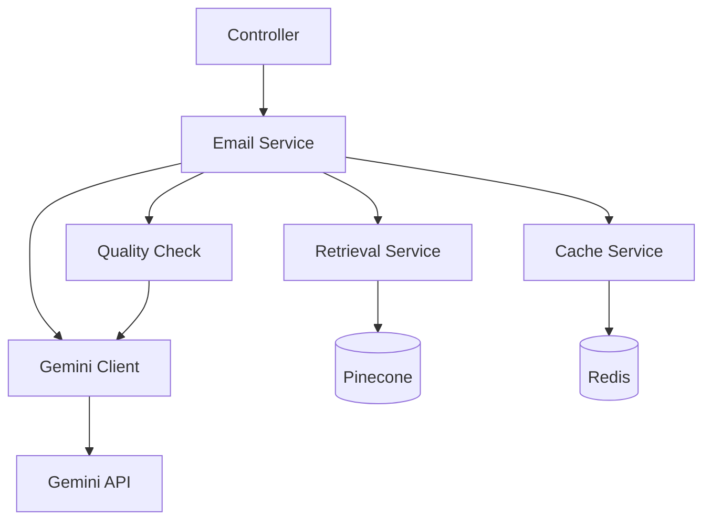
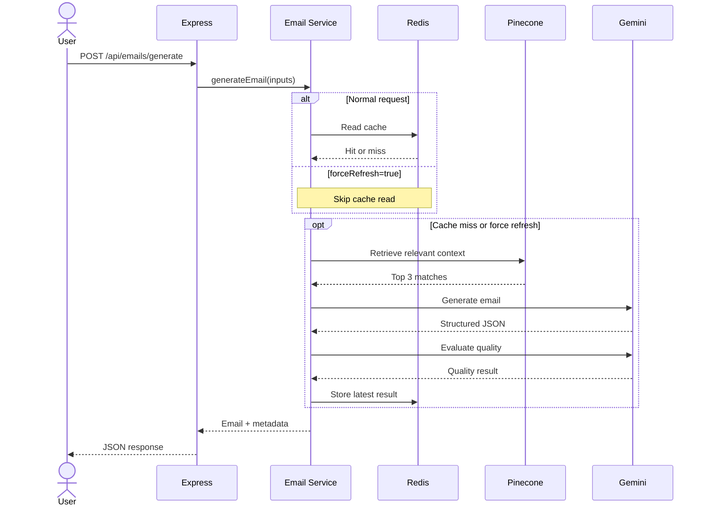

# MailMind AI

### **RAG**-Powered Email Generation API

**MailMind AI** is a modular Node.js and Express service that generates
context-aware emails using Google Gemini, **Pinecone** retrieval, and **Redis**
caching. It also provides AI-assisted quality evaluation, rate limiting,
and **Prometheus**-compatible metrics.


------------------------------------------------------------------------

## Contents

-   [Features](#features)
-   [Architecture](#architecture)
-   [**RAG** Workflow](#rag-workflow)
-   [Prompt Design](#prompt-design)
-   [API](#api)
-   [Caching](#caching)
-   [Performance and Monitoring](#performance-and-monitoring)
-   [Project Structure](#project-structure)
-   [Setup](#setup)

## Tech Stack

| Category | Technologies |
|---|---|
| **Backend** | Node.js, Express.js, JavaScript, REST API |
| **AI and LLM** | Google **Gemini 2.5 Flash**, Gemini Embedding |
| **RAG and Vector Search** | Retrieval-Augmented Generation (**RAG**), **Pinecone** |
| **Caching and Rate Limiting** | **Redis** |
| **Monitoring** | **Prometheus**, **Grafana** |
| **Load Testing** | **Autocannon** |
| **Frontend** | HTML, CSS, JavaScript |

## **RAG** and **Pinecone**

**Yes — **Pinecone** is used in this project.** It acts as the vector database
for the **RAG** retrieval stage. The application creates an embedding for the
email request using Gemini's embedding model, searches **Pinecone** for relevant
stored content, and passes the top retrieved matches into the Gemini email
generation prompt. **Pinecone** provides retrieval context; Gemini generates
the email.

## Features

-   Generate concise emails from purpose, recipient, and tone.
-   Retrieve relevant writing guidance from **Pinecone** before generation.
-   Return structured JSON with subject, body, and context summary.
-   Evaluate generated emails for purpose, tone, grammar, spelling, and
    readability.
-   Cache complete results in **Redis** to avoid repeated AI calls.
-   Support fresh generation through `forceRefresh`.
-   Apply **Redis**-backed API rate limiting.
-   Expose runtime metrics for **Prometheus** and **Grafana**.

## Architecture

## System Overview



### UML component view



### Request sequence



****Main flow:**** request → cache lookup → retrieval → generation → quality
evaluation → cache write → response. A cache hit returns early without
calling **Pinecone** or Gemini.

### Layered Architecture

- ****Presentation layer:**** Static HTML/CSS/JavaScript interface in `public/` for submitting email requests and displaying results.
- ****API layer:**** Express routes, middleware, and `emailController.js` handle requests, rate limiting, and JSON responses.
- ****Business/service layer:**** `emailService.js` orchestrates caching, **RAG** retrieval, email generation, and quality evaluation.
- ****Integration/data layer:**** `geminiClient.js` communicates with Gemini, `retrievalService.js` searches **Pinecone**, and `cacheService.js` uses **Redis**.
- ****Monitoring layer:**** **Prometheus**-compatible `/metrics` endpoint and **Grafana** dashboards support observability.

## **RAG** Workflow

1.  Build a retrieval query from the email purpose, recipient, and tone.
2.  Generate a query embedding using `gemini-embedding-001`.
3.  Search the **Pinecone** index for semantically similar content.
4.  Retrieve the top 3 matches.
5.  Add the retrieved content and relevance information to the
    generation prompt.
6.  Send the prompt to `gemini-2.5-flash`.

The Gemini embedding client requests 768 dimensions. The **Pinecone** index
and document-ingestion process must use a compatible dimension and
embedding configuration.

## Prompt Design

The generation prompt is organized into five parts:

  Part                Purpose
  ------------------- ------------------------------------------------------
  Role                Defines Gemini as a business email writing assistant
  User input          Supplies purpose, recipient, and tone
  Retrieved context   Adds relevant **Pinecone** guidance
  Instructions        Controls length, tone, and factual constraints
  Output schema       Requires structured JSON

Key instructions tell the model to: - Keep the email approximately
60--120 words. - Address the supplied recipient. - Follow the requested
tone and relevant retrieved guidance. - Avoid inventing facts, dates,
prices, policies, attachments, or promises. - Return exactly `subject`,
`body`, and `context_summary`.

****Generation configuration:**** `gemini-2.5-flash`, temperature `0.55`,
JSON response mode.

A second Gemini call evaluates the generated email. Purpose and tone
scores are model-generated estimates, not independently verified
accuracy measurements.

### AI Quality Check

After email generation, `qualityCheckService.js` makes a second Gemini call to assess **grammar, spelling, readability, purpose alignment, tone matching, and unsupported claims**. It returns structured scores, suggestions, and an overall status alongside the email response.

Quality scores are **LLM-generated estimates**, not guarantees of correctness. If evaluation fails, the email can still be returned with `qualityCheck: null`.

## API

### Generate email

`POST /api/emails/generate`

**Request**

``` json
{
  "purpose": "Request a meeting to discuss project progress",
  "recipient_name": "Rahul",
  "tone": "Professional",
  "forceRefresh": false
}
```

  Field              Type        Required Description
  ------------------ --------- ---------- -------------------------------
  `purpose`          string           Yes Email objective
  `recipient_name`   string           Yes Recipient name
  `tone`             string           Yes Desired tone
  `forceRefresh`     boolean           No Bypass cache read when `true`

**Response structure**

``` json
{
  "success": true,
  "data": {
    "recipient_name": "Rahul",
    "tone": "Professional",
    "subject": "Request for a Meeting",
    "body": "Dear Rahul,\n\nI hope you are doing well...",
    "contextSummary": "Applied professional email guidelines.",
    "retrievedSources": [],
    "qualityCheck": {}
  },
  "meta": {
    "model": "gemini-2.5-flash",
    "embeddingModel": "gemini-embedding-001",
    "ragEnabled": true,
    "indexedDocumentCount": 8,
    "retrievalTimeMs": 638,
    "generationTimeMs": 5939,
    "qualityCheckTimeMs": 4003,
    "totalAiTimeMs": 10580,
    "cache": {
      "hit": false,
      "source": "gemini"
    }
  }
}
```

The timing values are an observed sample. `retrievedSources` and
`qualityCheck` are abbreviated here to keep the example compact.

### Other endpoints

  Method   Endpoint        Purpose
  -------- --------------- ------------------------
  `GET`    `/api/health`   Check API availability
  `GET`    `/metrics`      **Prometheus** metrics

## Caching

**Redis** uses a cache key derived from `purpose`, `recipient_name`, and
`tone`. The `forceRefresh` flag is not part of the key.

  Action                                **Redis** read   AI pipeline   **Redis** write
  ----------------------------------- ------------ ------------- -------------
  Generate --- cache hit                       Yes            No            No
  Generate --- cache miss                      Yes           Yes           Yes
  Regenerate (`forceRefresh: true`)        Skipped           Yes           Yes

A normal request reuses the cached result when available. Regeneration
skips the cache read, executes retrieval and AI evaluation, then
overwrites the same cache entry.

## Performance and Monitoring

Two observed generation runs:

  Stage                          Run 1       Run 2
  ------------------------ ----------- -----------
  Retrieval                     638 ms      674 ms
  Gemini generation           5,939 ms    6,522 ms
  Quality evaluation          4,003 ms    6,031 ms
  Total measured AI time     10,580 ms   13,227 ms

These are individual observations, not a statistically representative
benchmark. `totalAiTimeMs` sums the three measured stages; it is not
end-to-end HTTP latency.

****Load test (health endpoint):****

``` bash
npx autocannon -c 10 -d 10 http://localhost:5000/api/health
```

Observed average latency: **1.49 ms** for this health-endpoint test.
This is not the AI generation latency.

**Prometheus** metrics observed during development include: -
`process_cpu_user_seconds_total` - `process_resident_memory_bytes` -
`nodejs_eventloop_lag_seconds`

**Grafana** can visualize metrics collected by **Prometheus**.

## Project Structure

``` text
src/
├── server.js
├── app.js
├── config.js
├── config/
│   ├── redis.js
│   └── metrics.js
├── controllers/
│   └── emailController.js
├── middleware/
│   ├── emailRateLimiter.js
│   └── monitoring.js
└── services/
    ├── emailService.js
    ├── geminiClient.js
    ├── retrievalService.js
    ├── cacheService.js
    └── qualityCheckService.js

public/
└── index.html
```

## How to Run the Project

### Requirements

-   Node.js and npm
-   **Redis**
-   Gemini API key
-   **Pinecone** API key and configured index

### 1. Clone the repository and install dependencies

```bash
git clone <YOUR_REPOSITORY_URL>
cd email-template-generator
npm install
```

Run these commands from the `email-template-generator` project directory.

### 2. Configure environment variables

Create a `.env` file in the project root. Add the **Pinecone** settings
required by your `config.js` and retrieval service, in addition to the
variables shown below.

``` env
PORT=5000
GEMINI_API_KEY=your_gemini_api_key
GEMINI_MODEL=gemini-2.5-flash
GEMINI_EMBEDDING_MODEL=gemini-embedding-001
REDIS_URL=redis://localhost:6379
```

Never commit `.env`; use placeholders in `.env.example`.

### 3. Start **Redis**

Make sure Docker Desktop is running, then start **Redis**:

```bash
docker run -d --name mailmind-redis -p 6379:6379 redis:7-alpine
docker exec -it mailmind-redis redis-cli ping
```

Expected output: `PONG`.

If the container already exists, start it with
`docker start mailmind-redis` instead of creating it again.

### 4. Start the application

Run the development script defined in `package.json`:

```bash
npm run dev
```

If your `package.json` does not define a `dev` script, use the
corresponding start script configured in that file.

Once the server starts, open `http://localhost:5000` to access the
static frontend (if it is served by the Express application).

### 5. Test the API

``` bash
curl -X POST http://localhost:5000/api/emails/generate \
  -H "Content-Type: application/json" \
  -d '{
    "purpose": "Request a project meeting",
    "recipient_name": "Rahul",
    "tone": "Professional",
    "forceRefresh": false
  }'
```

To force a fresh result, send the same request with
`"forceRefresh": true`.

### 6. Verify cache behaviour

1.  Send the same normal request twice.
2.  Confirm the second request logs `email_cache_hit`.
3.  Send it with `forceRefresh: true`; confirm the **RAG** pipeline runs and
    **Redis** is updated.
4.  Send the normal request again; confirm the refreshed result is
    returned from **Redis**.

## Reliability and Security Notes

-   Keep API keys in environment variables and exclude `.env` from Git.
-   Validate and limit request fields and body size.
-   Restrict CORS to trusted origins in production.
-   Use HTTPS and secure **Redis** network access in hosted environments.
-   Keep rate limiting and external-service timeouts enabled.
-   Avoid logging credentials or unnecessary personal data.
-   Add automated tests for cache behaviour, retrieval, model errors,
    and response validation before production deployment.

## Roadmap

-   Unit and integration tests for service and failure paths.
-   **Prometheus** counters for cache hits, misses, regenerations, and
    provider errors.
-   Token usage and estimated AI-cost tracking.
-   Retrieval evaluation against a curated test set.
-   Authentication and per-user usage controls.
-   Retry/backoff policies and distributed tracing.
-   Documented knowledge-base ingestion and re-indexing workflow.

------------------------------------------------------------------------

**MailMind AI** combines semantic retrieval, structured LLM generation,
quality evaluation, and cache-aside performance optimization in a
modular backend service.

## Performance and Load Testing

### Load Testing

**Autocannon** was used to run a basic concurrency test against the health
endpoint:

```bash
npx autocannon -c 10 -d 10 http://localhost:5000/api/health
```

In the observed run, the test used **10 concurrent connections** for
**10 seconds** and reported approximately **1.49 ms average latency**.
This result applies only to `/api/health`; it is not a benchmark of the
Gemini generation or **RAG** pipeline.
